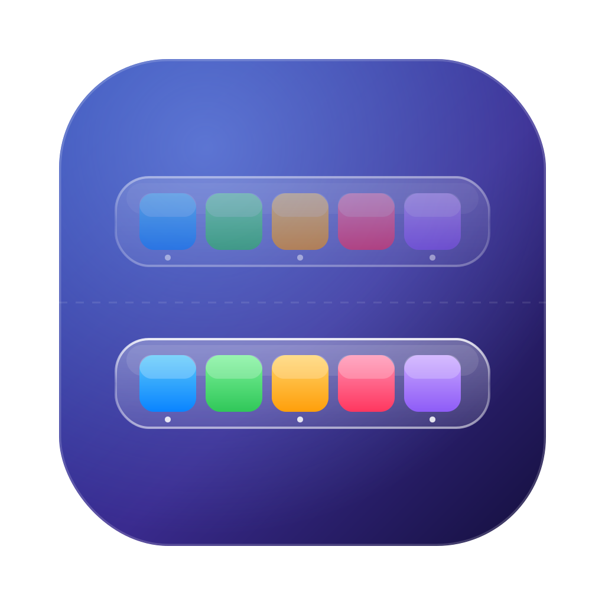

# DoubleMyDock

Копия системного Дока macOS на всех мониторах, где его нет. Выглядит так, будто macOS сама рисует две одинаковые панели.

**[Скачать DoubleMyDock.dmg](https://github.com/porwatkinoff-it/DoubleMyDock/releases/latest/download/DoubleMyDock.dmg)**

## Что повторяет

Через системный интерфейс «Универсального доступа» (тот же, которым пользуется VoiceOver) DoubleMyDock читает настоящий Док и рисует то же самое:

- значки в том же порядке, разделители, папки, Корзину, свёрнутые окна;
- точки под запущенными программами и красные счётчики уведомлений;
- размер панели, отступы и расстояние от края экрана;
- «жидкое стекло» на macOS 26 и размытие на macOS 13–15;
- увеличение при наведении, автоскрытие и положение (снизу, слева, справа) из настроек Дока;
- подпрыгивание значка при запуске программы и название при наведении;
- перетаскивание файлов на программы, папки и в Корзину;
- правый клик по значку: «Показать / Скрыть», «Завершить», «Показать в Finder».

Если перенести настоящий Док на другой монитор, копия сама переедет на экран, где Дока теперь нет.

## Установка

1. Откройте `DoubleMyDock.dmg` и перетащите DoubleMyDock в «Программы».
2. При первом запуске macOS скажет, что не может проверить разработчика. Откройте «Системные настройки» → «Конфиденциальность и безопасность» и нажмите «Всё равно открыть».
3. Разрешите DoubleMyDock доступ в «Конфиденциальность и безопасность» → «Универсальный доступ».
4. Если нужно запускать её при входе в систему: правый клик по пустому месту копии Дока → «Открывать при входе».

## Нагрузка

Один файл на Swift/AppKit, без сторонних библиотек. Настоящий Док опрашивается раз в секунду (несколько миллисекунд работы), анимации идут только во время движения. В простое процессор почти не используется.

## Ограничения

- Свёрнутые окна показываются значком документа, а не миниатюрой.
- Папки (например, «Загрузки») показываются значком папки, а не веером файлов. По клику папка открывается в Finder.
- macOS не даёт сторонним программам резервировать место на экране, как это делает Док. Поэтому, когда окно заходит на место копии, она прячется (так же Док ведёт себя в полноэкранном режиме) и выезжает, если подвести курсор к краю экрана.

## Сборка из исходников

Нужны macOS 13+ и Xcode 26 (для «жидкого стекла»; со старым Xcode соберётся без него).

```bash
bash build.sh
```

Скрипт соберёт приложение (Apple Silicon и Intel), установит его в `~/Applications`, запустит и сделает `dist/DoubleMyDock.dmg`. Релизы собирает GitHub Actions.
